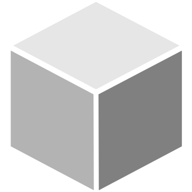
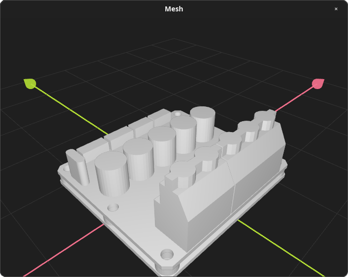
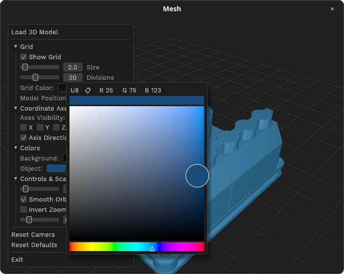

<div align="center">



**Mesh**

**A simple and lightweight 3D mesh viewer written in Rust.**

[](https://github.com/odevsa/mesh/releases/latest)
[](https://www.rust-lang.org/)
[](https://github.com/odevsa/mesh/releases/latest)
[](https://github.com/odevsa/mesh/releases/latest)
[](https://github.com/odevsa/mesh/releases/latest)

[Features](#features) •
[Screenshots](#screenshots) •
[Formats](#formats) •
[Installation](#installation) •
[Building](#building) •
[Contributing](#contributing)

<br/>



</div>

## Overview

**Mesh** is a simple desktop viewer designed to quickly inspect 3D files. It focuses on being lightweight and straightforward to use, making it easy to preview models and 3D prints without having to launch heavier software.

## Features

- **Lightweight & Fast**: Built in Rust with low memory footprint and instant startup.
- **Comprehensive 3D Format Support**:
  - **STL**: Binary and ASCII.
  - **3MF**: Modern additive manufacturing format with full vertex colors, submeshes, and material parsing.
  - **Wavefront OBJ**: Geometry with materials (`.mtl`) and relative texture map resolution.
  - **glTF / GLB**: Both embedded binary and external reference/buffer files.
  - **Autodesk FBX**: Binary and ASCII geometry with relative texture loading.
- **Advanced Lighting & Shading**:
  - Realistic multi-source lighting combining hemisphere ambient, directional key light, and camera headlight.
  - Interactive light and shadow color customization in real-time.
  - Wireframe overlay mode with depth preservation.
- **Internationalization (i18n)**: Multi-language interface with automatic system language detection and manual switching.
- **Intuitive Camera Controls**: Orbit, pan, and zoom with smooth momentum damping.
- **Reference Grid & Coordinate Axes**: Configurable ground grid and 3D orientation gizmo.
- **Persistent Preferences**: Visual settings, colors, and camera configurations are automatically saved between sessions.
- **Multi-Platform**: Native packages, and zero external runtime dependencies.

## Screenshots

<div align="center">




</div>

## Formats

| Format            |    Extension    | Capabilities & Support                                                    |
| :---------------- | :-------------: | :------------------------------------------------------------------------ |
| **STL**           |     `.stl`      | Standard Stereolithography format (Binary and ASCII)                      |
| **3MF**           |     `.3mf`      | 3D Manufacturing Format with vertex color mapping and multi-submesh trees |
| **Wavefront OBJ** |     `.obj`      | Polygonal mesh geometry, MTL materials, and relative texture paths        |
| **glTF / GLB**    | `.gltf`, `.glb` | GL Transmission Format (embedded GLB, external GLTF buffers and images)   |
| **Autodesk FBX**  |     `.fbx`      | Filmbox exchange format (Binary & ASCII) with relative texture resolution |

## Installation

Mesh is distributed as both native installers and standalone portable binaries:

Download the latest release for your operating system from the **[Releases](https://github.com/odevsa/mesh/releases)** page:

### Linux

Choose your preferred package format:

- **AppImage** (universal, self-contained):
  ```bash
  chmod +x mesh-*-linux-x86_64.AppImage
  ./mesh-*-linux-x86_64.AppImage
  ```
- **Debian / Ubuntu** (`.deb`):
  ```bash
  sudo dpkg -i mesh-*-linux-x86_64.deb
  ```
- **Portable Tarball** (`.tar.xz`): Extract and run the standalone `mesh` binary directly.

### macOS

- Download `mesh-*-macos-arm64.dmg` (Apple Silicon) or `mesh-*-macos-x86_64.dmg` (Intel).
- Open the `.dmg` disk image and drag **Mesh.app** to your `/Applications` directory.

### Windows

- Download `mesh-*-windows-x86_64.exe` (or `mesh-*-windows-arm64.exe`) installer and follow the setup wizard.

## Usage

### From GUI

Launch `Mesh` and **double-click** anywhere or **right-click** to open the context menu and select **"Load 3D Model"** (or use drag-and-drop).

| Action                      | Shortcut / Gesture                                         |
| :-------------------------- | :--------------------------------------------------------- |
| **Orbit Camera (Mouse)**    | `Left Click` + Drag (with smooth momentum damping)         |
| **Orbit Vertical (Keys)**   | `↑` / `↓` (Arrow Up / Down)                                |
| **Orbit Horizontal (Keys)** | `←` / `→` (Arrow Left / Right)                             |
| **Zoom In / Out**           | `Mouse Wheel` or `+` / `-` keys (speed & dir customizable) |
| **Context Menu**            | `Right Click` anywhere                                     |
| **Open File Dialog**        | `Double Click (LMB)` or select in Context Menu             |
| **Close Menu / Exit**       | `Esc`                                                      |

### From Command Line

Pass the path to any supported 3D model directly:

```bash
# Linux and macOS
./mesh /path/to/model.stl

# Windows
mesh.exe C:\models\model.3mf
```

## Development & Building

Tasks are managed using [`just`](https://github.com/casey/just) (a modern command runner written in Rust). A backward-compatible `Makefile` wrapper forwarding to `just` is also included.

| Command              | Description                                                         |
| :------------------- | :------------------------------------------------------------------ |
| `just dev`           | Run application in development mode (`cargo run`)                   |
| `just dev-demo`      | Run application previewing sample asset (`Suzanne.glb`)             |
| `just check`         | Run compiler checks across the codebase (`cargo check`)             |
| `just test`          | Run all unit and integration tests (`cargo test`)                   |
| `just lint`          | Validate code formatting and clippy rules                           |
| `just format`        | Auto-format Rust source files (`cargo fmt`)                         |
| `just build`         | Build optimized release binary for host platform into `dist/linux/` |
| `just build-linux`   | Build release binary for Linux                                      |
| `just build-windows` | Cross-compile Windows binary using MinGW GNU toolchain              |
| `just build-macos`   | Compile release binary and generate macOS application bundle        |
| `just icons`         | Regenerate all OS icon assets from `assets/mesh.svg`                |
| `just version <V>`   | Synchronize semantic version across manifests (e.g. `0.2.0`)        |
| `just release [os]`  | Test GitHub Actions release workflows locally using `act`           |

> **Note**: You can also use standard `make <target>` commands (e.g., `make dev`, `make test`, `make build`, `make icons`) or standard `cargo build --release`.

## Contributing

Contributions, bug reports, and suggestions are welcome!

1. Fork the repository
2. Create your feature branch (`git checkout -b feature/amazing-feature`)
3. Commit your changes (`git commit -m 'feat: Add amazing feature'`)
4. Push to the branch (`git push origin feature/amazing-feature`)
5. Open a Pull Request

Feel free to open an [Issue](https://github.com/odevsa/mesh/issues) if you find a bug or have an idea for a new feature.
